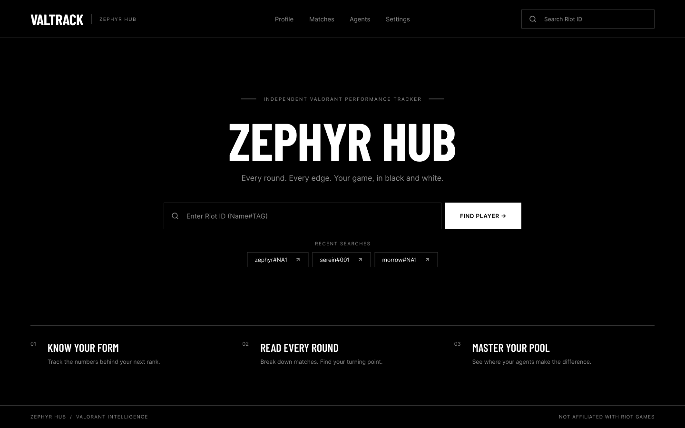
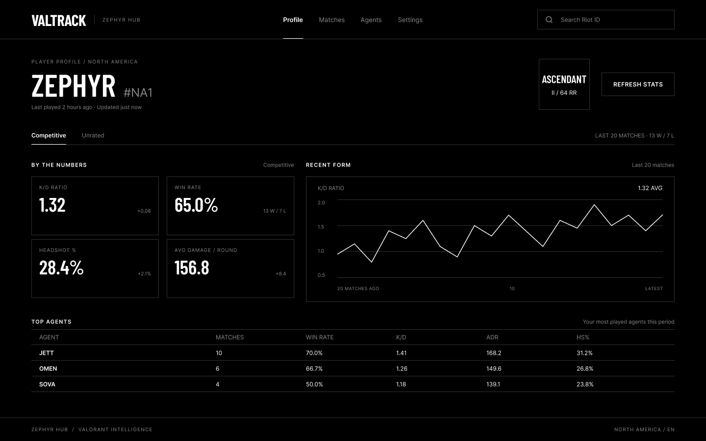
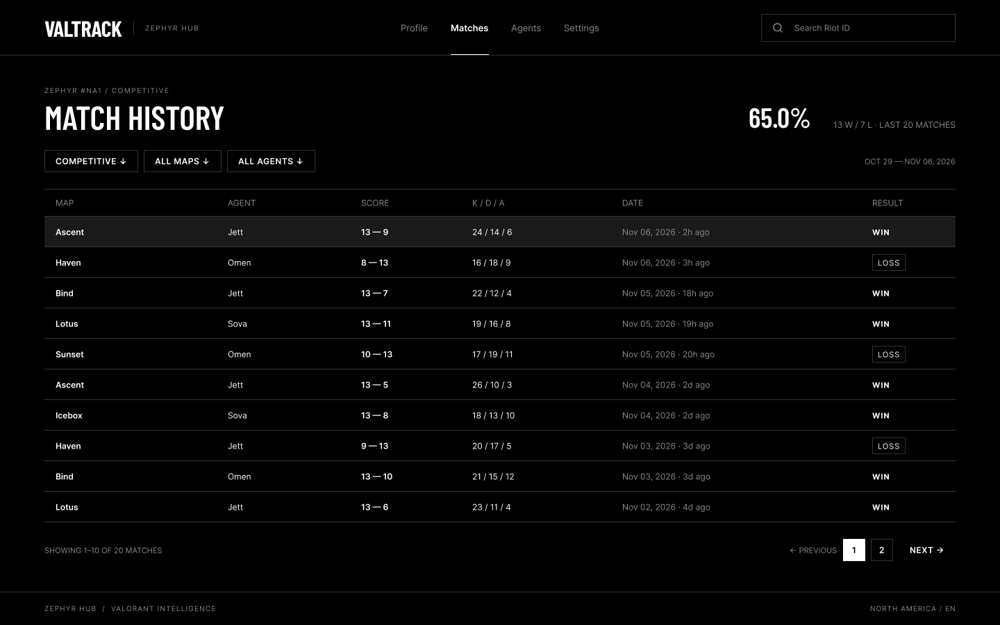
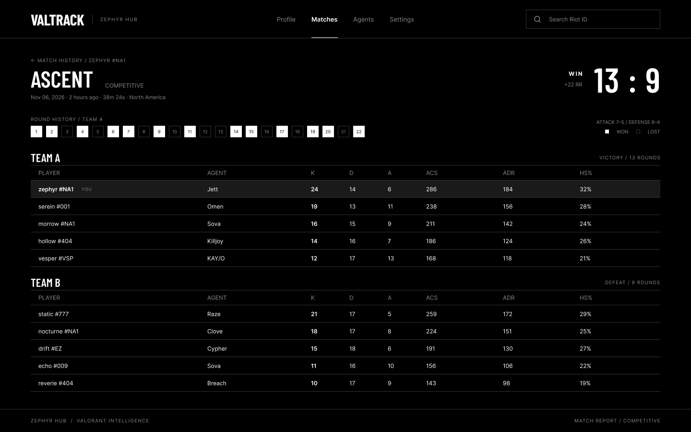
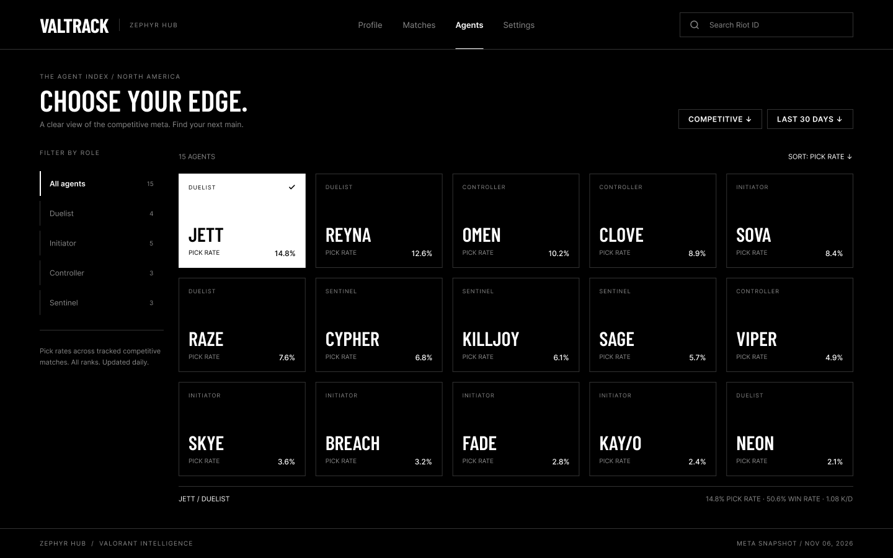
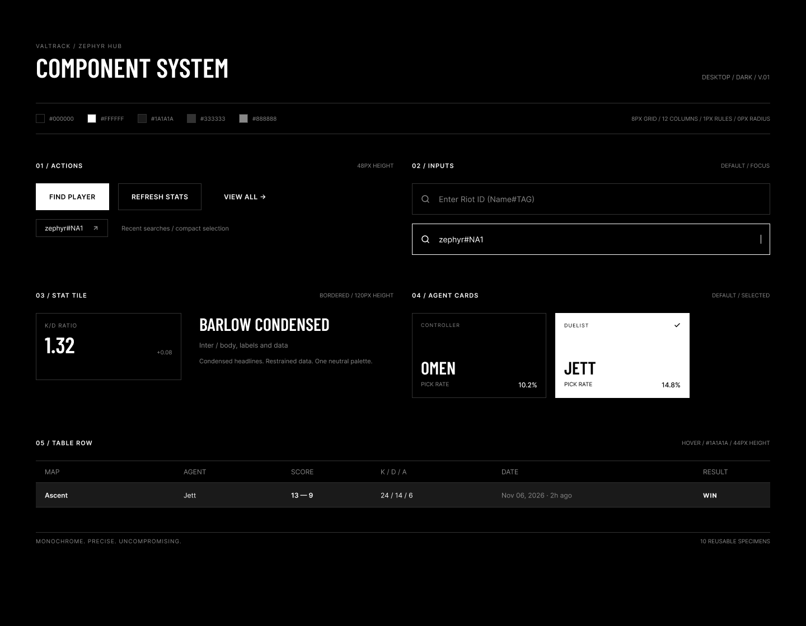

# ZEPHYR HUB

**An independent Valorant performance tracker, in black and white.**

Every round. Every edge. Your game, stripped down to the numbers.

 

 

## Why this exists

Most stat trackers I tried felt like ad boards with a scoreboard stuck on top. Neon everywhere, a dozen widgets fighting for attention, and the one number I actually opened the page for was buried somewhere in the corner.

So I built the opposite. Zephyr Hub is black, white and a few shades of gray. Condensed type, thin lines, no rounded corners, no decoration. You type a Riot ID, you get your numbers, you close the tab and go play.

## What you get

**Profile.** K/D, win rate, headshot percentage and average damage per round for your last 20 matches, each with the change since the previous period. Below that, a K/D form chart so you can see whether you're heating up or tilting, and a breakdown of your most played agents.

**Match history.** A clean table of your recent games: map, agent, score, K/D/A, date and result. Filter by queue, map or agent. Wins stay quiet, losses get a box around them so they're easy to spot.

**Match report.** Open any game to see the full scoreboard for both teams with K, D, A, ACS, ADR and HS%, plus the round-by-round history and the attack/defense split.

**Agent index.** Pick rates across tracked competitive matches, filterable by role. Select an agent to see its pick rate, win rate and K/D at the bottom of the page.

## Screenshots

### Player Profile

### Match History

### Match Report

### Agent Index

## Installation

Builds are published **only through Releases**. Nothing else is an official download.

1. Open the [Releases page](../../releases/latest).
2. Download the latest build from the **Assets** section.
3. Run it.

That's it. If you grabbed it from anywhere other than this page, delete it and get it from here instead.

## How it works

1. Enter your Riot ID in the format `Name#TAG`.
2. Zephyr Hub pulls your recent competitive and unrated matches.
3. Stats are calculated over your last 20 games and shown on your profile, with the match list and individual reports one click away.
4. Hit **Refresh Stats** after a session to pull in anything new.

Your last few searches are kept so you can jump back to a profile in one click. Agent pick rates are a daily snapshot, updated once a day.

## Design

The whole interface runs on a small set of rules, which is most of what makes it feel calm:

| | |
|---|---|
| **Palette** | `#000000` `#FFFFFF` `#1A1A1A` `#333333` `#888888` |
| **Headlines** | Barlow Condensed |
| **Body and data** | Inter |
| **Grid** | 8px base, 12 columns |
| **Lines** | 1px rules everywhere |
| **Corners** | 0px radius, always |

Buttons are 48px tall, stat tiles 120px, table rows 44px. Selected states are a straight inversion: white card, black text. Hover on a row lifts it to `#1A1A1A`. No color is ever used to carry meaning, so nothing depends on telling red from green.

## Roadmap

- [ ] Unrated and other queue breakdowns
- [ ] Per-map performance
- [ ] Longer history than 20 matches
- [ ] Comparing two players side by side

No promises on order or dates. This is a side project.

## Disclaimer

Zephyr Hub is not endorsed by Riot Games and does not reflect the views or opinions of Riot Games or anyone officially involved in producing or managing Riot Games properties. Riot Games and all associated properties are trademarks or registered trademarks of Riot Games, Inc.

## Feedback

Found a bug or have an idea? Open an [issue](../../issues). Screenshots help.

 

